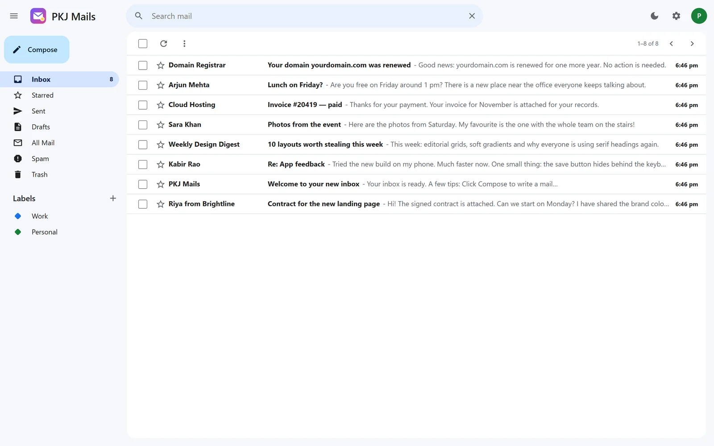
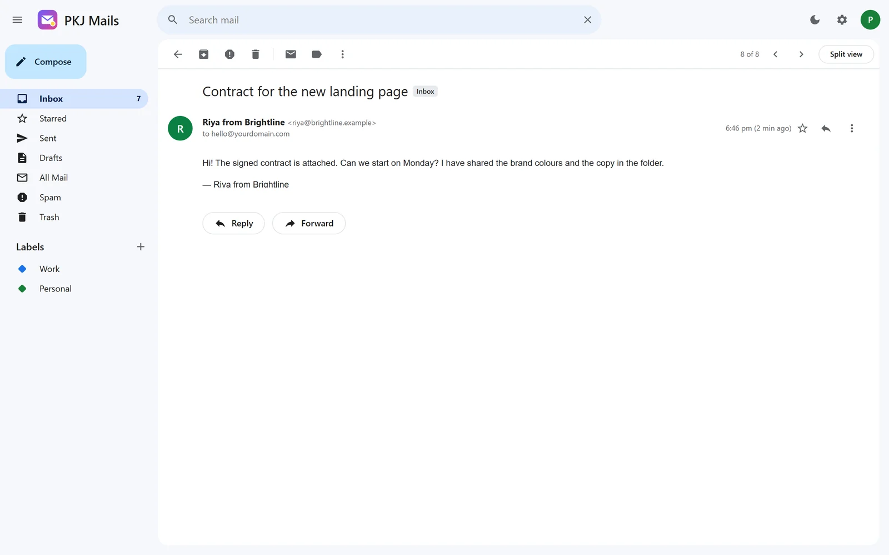
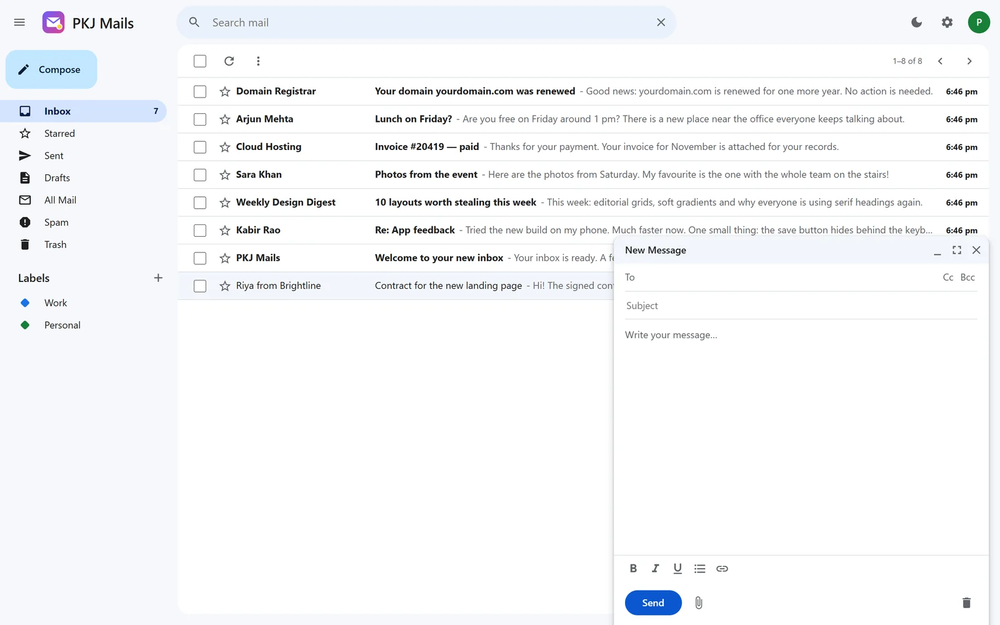
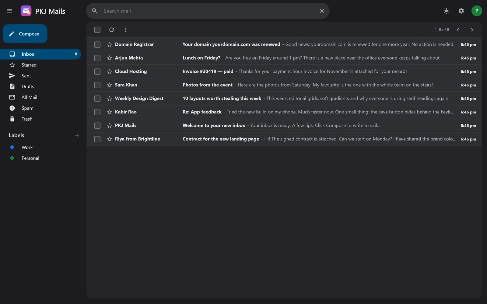
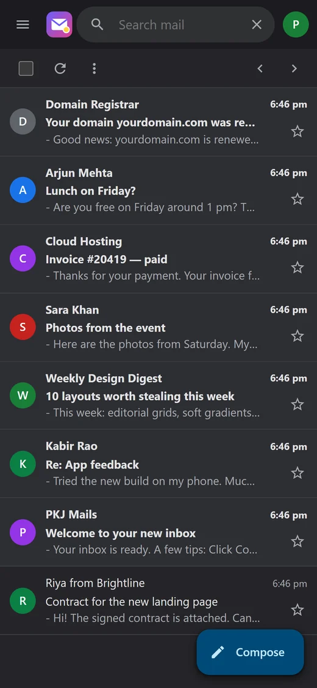
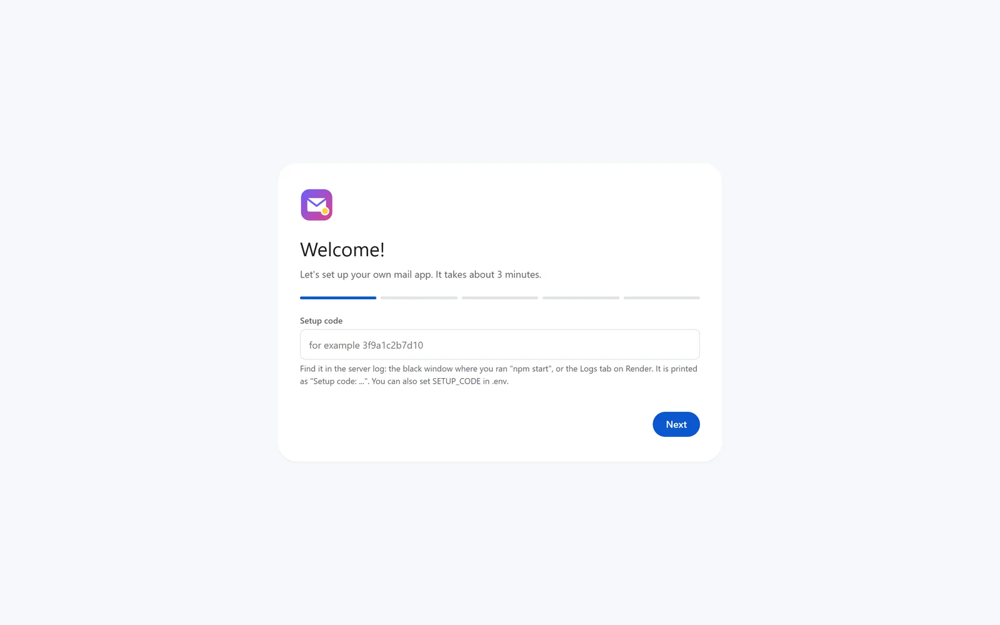
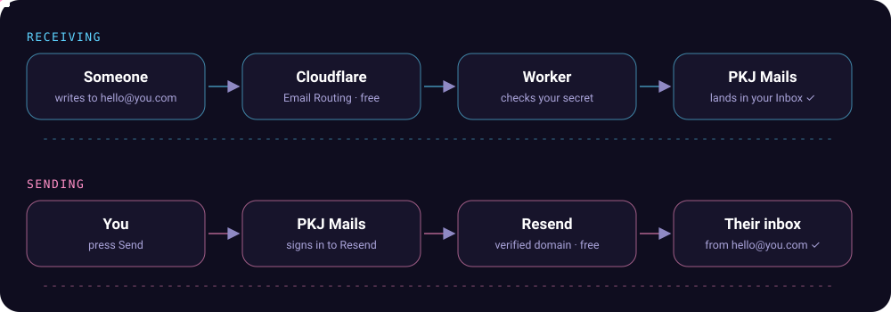

<p align="center"></p>

<h1 align="center">PKJ Mails</h1>

<p align="center"><b>Your own webmail — with your own domain address.</b><br>
A clean, familiar inbox you run yourself. Read and send mail as <code>you@yourdomain.com</code>, on any computer or server.</p>

<p align="center">
<a href="https://render.com/deploy?repo=https://github.com/pankaj-pkj/pkj-mails"></a>
</p>

<p align="center">


</p>

<p align="center"></p>

---

## Pick your path

You do **not** need to know programming. Choose what you want to do and follow that guide only.

| I want to… | Guide | Time |
|---|---|---|
| 🖥️ **Try it on my computer** | [Path A below](#path-a--try-it-on-your-computer) | 10 min |
| 🌍 **Put it online (free)** so I can open it from any phone or laptop | [Path B below](#path-b--put-it-online-free) | 15 min |
| ✉️ **Get my own address** like `hello@mybrand.com` | [docs/OWN-DOMAIN.md](docs/OWN-DOMAIN.md) | 45 min, once |
| 📬 **Just read my Gmail / Outlook** in a nicer inbox | Path A or B, then [use Gmail](#using-gmail-or-outlook) | +5 min |

---

## What you get

<table>
<tr>
<td width="50%"></td>
<td width="50%"></td>
</tr>
<tr>
<td width="50%"></td>
<td width="50%" align="center"></td>
</tr>
</table>

- **A familiar inbox:** Inbox, Starred, Sent, Drafts, All Mail, Spam, Trash and your own Labels.
- **Conversations:** replies stay together in one thread; older mails fold up.
- **Archive, star, labels, search** — e.g. `from:ana is:unread has:attachment invoice`.
- **Undo Send** (5–30 seconds), reply, reply all, forward, attachments with drag and drop.
- **New mail shows up instantly**, with optional desktop notifications.
- **Tracking pixels blocked:** remote images stay hidden until you allow them.
- **Your brand:** change the app name, logo and colour in Settings → Branding.
- **Works on phones**, light and dark mode, keyboard shortcuts (press `?`).
- **Any database:** SQLite (zero setup), MongoDB, PostgreSQL, MySQL or Firebase — change one line.
- **Send** through Resend, Brevo, Gmail, Outlook, Zoho or any SMTP server. **Receive** by IMAP or straight from your domain.
- **Safe by default:** hashed password, encrypted mail passwords, CSRF protection, rate limits, cleaned mail HTML in a locked frame.

---

## Path A — Try it on your computer

<p align="center"></p>

### 1. Install Node.js
Download the **LTS** version (22 or newer) from **https://nodejs.org** and install it (keep clicking *Next*).

To check, open a terminal — **Windows:** press the Windows key, type `cmd`, Enter · **Mac:** open *Terminal* — and type:

```bash
node -v
```

You should see something like `v22.11.0`.

### 2. Download PKJ Mails
On this page click the green **Code** button → **Download ZIP**, then unzip it (right-click → *Extract all*).

> Windows tip: open the unzipped folder, click the address bar, type `cmd`, press Enter — a terminal opens in the right place.

### 3. Start it

In the terminal opened **inside the PKJ Mails folder** (see the tip above), type these two lines — press Enter after each:

```bash
npm install
npm start
```

You'll see:

<p align="center"></p>

> Keep this window open — closing it stops your mail app. Copy the **setup code** for the next step.

### 4. Finish setup in the browser



1. Open **http://localhost:3000** and type the **setup code** from the terminal.
2. Create your login (email + a password of 10+ characters).
3. **Sending:** click your provider (Gmail, Resend, Brevo…), fill the fields, press **Send a test mail** — green tick = done.
4. **Receiving (optional):** fill IMAP and press **Test receiving**, or skip and do it later in Settings.
5. Press **Finish setup** and sign in. 🎉

Stop with `Ctrl + C`. Start again with `npm start`.

> **No settings file needed on your computer.** PKJ Mails uses SQLite and creates its own secret key on the first start.
> You only need a `.env` file to choose another database or fix your settings — copy `.env.example` to `.env`
> and read the comments inside. Online hosts (Render) use their *Environment* page instead.

---

## Path B — Put it online (free)

1. Get a free database: **MongoDB Atlas** (M0 cluster) or **Neon Postgres**. Copy its connection link.
2. Click **Deploy to Render** at the top of this page and sign in with GitHub.
3. Render asks for two values:
   - `DATABASE_URL` — the link from step 1
   - `SETUP_CODE` — any long word only you know, like `blue-tiger-river-42`
4. Click **Apply**. When the log says `PKJ Mails is running`, open your `https://…onrender.com` link and finish setup (step 5 above).

Step-by-step with every click: **[docs/DEPLOY-RENDER.md](docs/DEPLOY-RENDER.md)** · Own server instead: **[docs/DEPLOY-VPS.md](docs/DEPLOY-VPS.md)**

> Don't use SQLite on Render's free plan — its disk is wiped on restart. Use MongoDB or Postgres there.

---

## Your own domain address

Want `hello@yourdomain.com` instead of a Gmail address? **[docs/OWN-DOMAIN.md](docs/OWN-DOMAIN.md)** walks you through it with clicks only:

<p align="center"></p>

1. **Receive:** Cloudflare Email Routing (free) hands every mail for your domain to PKJ Mails.
2. **Send:** Resend (free plan) sends your mail as `you@yourdomain.com`.
3. **Inbox, not spam:** three DNS records copied from Resend + one DMARC line.

You only pay for the domain itself.

---

## Using Gmail or Outlook

**Gmail** needs an *App password* (your normal password won't work):

1. Turn on **2-Step Verification**: https://myaccount.google.com/security
2. Open https://myaccount.google.com/apppasswords → name it "PKJ Mails" → **Create** → copy the 16-letter password.
3. On the setup page click **Gmail**; username = your Gmail address, password = the 16-letter code (same for IMAP).
4. Gmail → Settings → **Forwarding and POP/IMAP** → make sure **IMAP is enabled**.

**Others:** the setup page fills server details for Outlook, Zoho, Brevo and Resend when you click their name.

---

## Choose a database

Change `DB_TYPE` in `.env` (or Render → Environment) and restart. Tables are created automatically.

| `DB_TYPE` | Best for | What to fill | Free option |
|---|---|---|---|
| `sqlite` | Your computer or a VPS | nothing | built in |
| `mongodb` | Render and similar hosts | `DATABASE_URL=mongodb+srv://…/pkjmails` | MongoDB Atlas |
| `postgres` | Render and similar hosts | `DATABASE_URL=postgres://…/pkjmails` | Neon, Supabase |
| `mysql` | Shared hosting / cPanel | `DATABASE_URL=mysql://…/pkjmails` | often included |
| `firebase` | If you already use Firebase | `FIREBASE_DB_URL` + `FIREBASE_DB_SECRET` | Spark plan |

---

## How mail comes in

- **IMAP** — reads an existing mailbox (Gmail, Outlook, Zoho…) every 60 seconds. Easiest.
- **Your domain** — Cloudflare Email Routing → a tiny Worker → PKJ Mails. See [OWN-DOMAIN.md](docs/OWN-DOMAIN.md).
- **Any other service** — `POST /api/inbound` with header `Authorization: Bearer <INBOUND_SECRET>`; body = raw mail (`message/rfc822`) or JSON `{ "from", "to", "subject", "text", "html" }`.

---

## Something went wrong?

| You see | Fix |
|---|---|
| `'node' is not recognized` | Install Node.js, then close and reopen the terminal. |
| `PKJ Mails needs Node.js 22 or newer` | Install the latest LTS from nodejs.org. |
| `Port 3000 is already in use` | Put `PORT=3001` in `.env`. |
| `SMTP login failed` | Wrong username/password. Gmail needs an **App password**; Resend's username is `resend`. |
| `SMTP server did not answer` | 465 = Secure **on**, 587 = Secure **off**. |
| `The setup code is wrong` | Find `Setup code: …` in the terminal / Render logs, or set `SETUP_CODE`. |
| Forgot the password | Put `ADMIN_EMAIL=` and `ADMIN_PASSWORD=` in `.env` and restart. |

Everything else: **[docs/TROUBLESHOOTING.md](docs/TROUBLESHOOTING.md)**

---

## Security

**"The code is public — can someone read it and break into my inbox?"** No. Security here does not depend on hiding the code;
it depends on secrets only you have: your password, `APP_SECRET`, `INBOUND_SECRET` and your mail-provider passwords.
Those live in `.env` (never uploaded) or encrypted in your database.

- Password hashed with scrypt; saved SMTP/IMAP passwords encrypted with AES-256-GCM.
- Sessions in HttpOnly, SameSite=Strict cookies; only their hash is stored. Password change signs out every other device.
- CSRF token + custom header on every change; sign-in, setup code, sending and inbound are rate limited.
- Mail HTML is stripped of scripts and shown in a sandboxed frame; attachments always download.
- Executables can't be sent as attachments; logos must be real images.
- Set `TRUST_PROXY=1` only behind a proxy (Render, Nginx, Cloudflare).

Found a problem? Please open a **private security advisory** on GitHub instead of a public issue.

---

## For developers

```bash
npm test        # adapter + API tests (memory and SQLite always; others with TEST_*_URL)
npm run dev     # restarts on file changes
```

```
src/server.js     starts the app, reads .env
src/app.js        the API (/api/...)
src/security.js   passwords, sessions, rate limits, encryption
src/db/           storage adapters: sql.js (sqlite/postgres/mysql), mongo.js, firebase.js, memory.js
src/mail/         MIME parser, HTML sanitizer, SMTP/IMAP, settings
public/           the inbox (plain JavaScript, no build step)
docs/             guides + the Cloudflare email worker
```

Add a database: copy `src/db/memory.js`, fill the same methods, register it in `src/db/index.js`.

## License

MIT — free to use, change and share. See [LICENSE](LICENSE).

Made by **[Pankaj Kumawat](https://www.codianstudio.org/)** · Codian Studio.
PKJ Mails is an independent project and is not affiliated with Google, Gmail, Cloudflare, Render or Resend.
